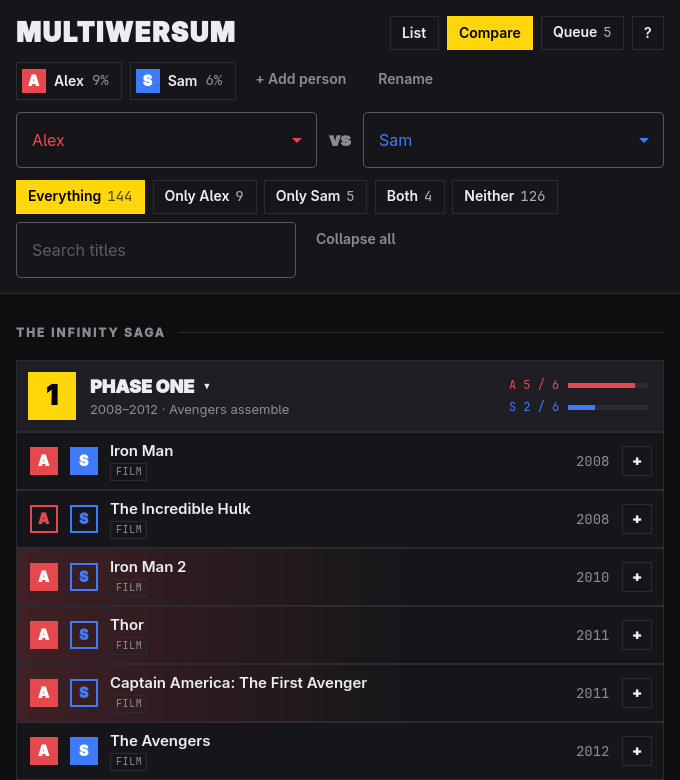

# Multiwersum



Tick off every Marvel film and series as you watch them, compare what each
person has seen, and keep a shared queue of what to watch next.

The catalog covers the MCU phase by phase (Phases 1–6, films, series,
animation, and specials, one row per season), the Marvel Television shows
that are now part of the MCU timeline (Netflix and ABC), and Marvel outside
the MCU (Sony's Spider-Man films, Fox's X-Men and Fantastic Four, and older
films). It was written in mid-2026; titles that haven't premiered are marked
as upcoming.

- **List** — one person's ticks, with a progress bar, filters, and search.
- **Compare** — two people side by side: only A, only B, both, or neither.
- **Queue** — a shared, ordered list of what to watch next, with ticks for
  everyone and a button that adds the next MCU title nobody has seen.
- Up to four people, each with their own color.

The window follows the Omarchy accent and window rounding live, and the
language set under Setup > Language (English and Polish are included).

## Install

```sh
bin/install   # builds, then installs the package with makepkg -fsi
```

The app then appears in the launcher (Super + Space) as Multiwersum.

## Keyboard

| Key | Action |
|---|---|
| ↑ ↓ / J K | Move between titles |
| Space | Tick or untick for the selected person |
| Shift+Space | Tick for the second person when comparing |
| Enter / + | Add to or remove from the queue |
| N | Queue the next MCU title nobody has seen |
| 1 2 3 | List, Compare, Queue |
| [ ] | Previous or next person |
| P / R | Add a person / rename the selected person |
| F | Next filter |
| / or Ctrl+F | Search |
| ← → | Collapse or expand the current group |
| C | Collapse or expand everything |
| T, Ctrl+↑, Ctrl+↓ | Queue: move to the top, up, down |
| Delete | Queue: remove the title |
| Ctrl+Z / Ctrl+Shift+Z | Undo and redo |
| Esc | Clear the search or close the shortcuts |
| ? | Show or hide shortcuts |
| Q | Quit |

## Command line

Every command works without a display, so scripts and agents can use it.

```sh
multiwersum status [--json]            # watched counts per person and the queue
multiwersum list [--json]              # every title with its id
multiwersum mark endgame --profile Ola # tick a title (--unmark to undo)
multiwersum queue add loki-2           # add to the queue (or remove)
multiwersum import export.json         # replace the saved list with a JSON export
```

## Data

Everything is saved to `~/.local/share/multiwersum/state.json` after every
change, written beside the file and renamed so a crash never leaves it half
written. `import` accepts this file's format and the web version's export.

## Develop

```sh
bin/build   # build/multiwersum
bin/test    # backend tests, offscreen
```
